# Physarum: a slime mold simulator for the browser

An interactive simulation of the slime mold _Physarum polycephalum_. Many simple agents leave
trails and follow them, and transport networks appear: they connect food, flee light, shrink,
heal and compete. With the rules of the growth front, a colony grows out as a sheet with veins.
Everything runs on your graphics card, in the browser.

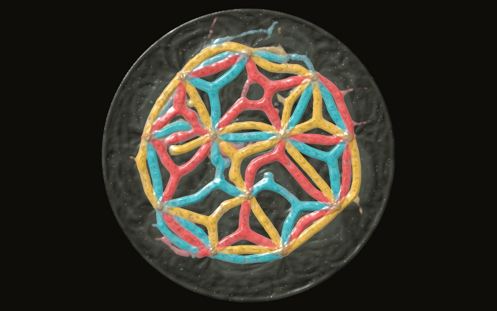

_Four strains in a dish of 1,024 × 1,024 cells at step 12,000. Each strain grew from a food of its
own in the middle and flees the trail of the others, so four networks of tubes wind around each
other between the 16 foods. The grey film below them is the slime that the colonies left behind.
This is the start scene with a fourth strain and a larger dish, in the app's own view: the Gel
style, Show slime, and the tubes drawn by their flow._

**Live:** <https://karstensiemer.github.io/physarum-slime-mold/>

## What you can do

- Watch the **start scene**: three rival strains grow from three foods, and each builds a network
  of tubes of its own. The scenes under Start here and Experiments run the rules of the organism:
  one agent per cell, growth and shrinkage, the flow in the tubes and the slime
  ([ADR 0064](docs/adr/0064-the-scenes-run-the-rules-of-the-organism.md)).
- Place up to **four strains** side by side, give each a color and its own behaviour, and set
  how strongly each strain follows or flees the others.
- Change every parameter of the Jones (2010) model live: sensor angle, sensor distance,
  rotation angle, step size, deposit, decay, random turns, population, diffusion.
- Paint **food** (attracts), **light** (repels), **walls**, **slime**, inoculate agents, or **cut**
  a wound and watch it heal.
- Run **experiments**: mazes, light avoidance, rival networks, the Y-maze with slime of Reid et
  al. (2012), the Crown of veins and the Tokyo rail network of Tero et al. (2010) with the rules of
  the organism. The experiments of papers run as their paper sets them: the maze of Nakagaki et
  al. (2000) with its protocol, and from the papers on Jones' model the shortest path, Steiner
  tree, shrinking plasmodium, wound healing, a coarsening network, electrotaxis and a Voronoi
  diagram.
- Turn on **flow in the tubes**: tubes that carry flow between foods stay, the others starve.
  The Maze then keeps one tube along a short route. The picture draws every tube as wide as its
  flow memory says: a tube that keeps much flow stays thick, the others get thin and faint. Small
  grains move back and forth in each tube with the flow.
- Turn on the **rules of the growth front**: the colony pushes its ground open at its rim, the
  rim draws the flow, and the flow pays the growth. Veins grow in one sheet and fork toward the
  rim (below).
- See the **slime** that a colony leaves behind: a wet film on the ground shows where the colony
  was. The film is thick where a tube stayed, so you still see the shape of a tube after it is
  gone, and it gets thinner as the slime gets older. A brush coats ground with slime. With the
  rules of the growth front the slime changes the run: the rim takes 40 times less flux on slime
  than near fresh ground, so a colony grows away from slime, as the slime mold of Reid et al.
  (2012) does ([ADR 0055](docs/adr/0055-the-slime-field.md),
  [ADR 0088](docs/adr/0088-the-scenes-of-reid-run-the-rules-and-the-avoidance-of-slime-is-a-setting.md)).
- Read what each scene shows: where its settings come from, what to watch, and why it uses them.
- Switch looks (glow, gel relief, paper, agents), pan and zoom, save a PNG, share the settings,
  the scene and its food, light and walls as a link.
- Learn: the biology, the paper behind the model and its six steps, every control and every
  scene, with references.

## The growth front and the crown of veins

A real slime mold grows at its front: a sheet of plasm fans out, and veins form in it that join
into thick tubes behind it. The switch **Rules of the growth front** (extended model, with growth
and the flow) grows a colony in this way
([ADR 0065](docs/adr/0065-the-growth-front-takes-the-flow-a-prototype.md),
[model, 6.10 to 9.1](docs/model.md#610-the-territory-of-each-strain)):

- **A ground of its own.** Each strain has a ground, its territory. Its agents move and are born
  only there. The agents at the edge push the ground open: a cell beside it joins with a chance of
  about 0.4 % per step for each agent of the strain next to it.
- **The rim draws the flow.** The agents at the edge with free ground beside them are the sinks of
  the flow, so the tubes carry flux from the foods to the rim. On slime the rim takes 40 times
  less flux than near fresh ground, by default.
- **The flux pays the growth.** Every birth costs one from a budget of the strain, and every death
  gives one back. The flux to the rim fills the budget, more for each food that the colony covers.
  So the colony grows with its food, and its sheet thins behind the rim.
- **The levers of the crown.** The switch also sets the flow over 8 neighbours, a base conductance
  of 0.002 and twice the flux to the front, and it raises the Flow strength to 8
  ([ADR 0098](docs/adr/0098-the-switch-of-the-rules-sets-the-levers-of-the-crown.md)). With them,
  the strong tubes in the sheet become veins.
- **Veins in the picture.** The view draws a tube of strong flow as a vein: in a deeper, darker
  shade of the colour of its strain, and in the Gel style as a low ridge
  ([ADR 0099](docs/adr/0099-the-veins-in-the-picture.md)).

The scene **Crown of veins** runs these rules in a box of 520 × 340 cells
([ADR 0087](docs/adr/0087-the-crown-as-a-scene.md)). The colony starts on a food at the closed end
of a narrow neck, leaves the neck as one sheet and spreads as a half disc. A few main veins run
from the neck toward the rim and fork there. Later these forks go, and new ones grow at the new
rim. Here at step 12,000:

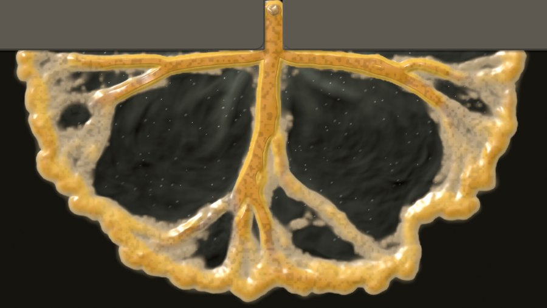

The same run at the steps 4,000, 8,000, 12,000 and 16,000:

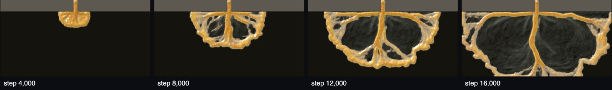

The crown of a real slime mold has more: a lobed rim, and a sheet that moves on ahead of its tube
and leaves the veins behind. This scene has neither
([ADR 0085](docs/adr/0085-the-crown-so-far.md)).

**Food ring** with the switch on, on 384 × 384 cells: the colony grows from the middle food as a
sheet with veins, covers the ring of eight foods as a mesh with holes, and then thins to a
network of a few thick tubes between the foods. Steps 2,000, 6,000, 12,000 and 20,000:

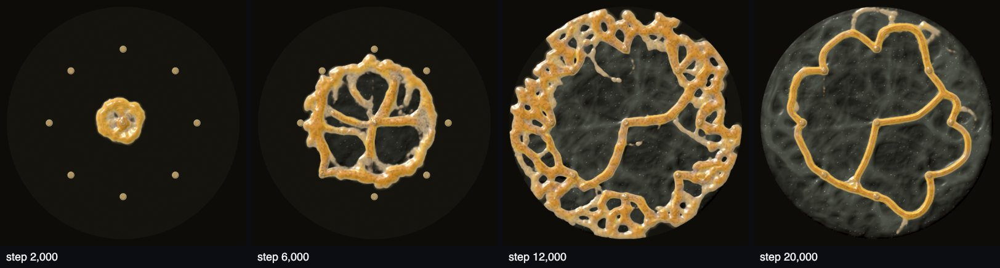

The scenes Crown of veins, the three scenes of the Y-maze and Slime everywhere run the rules. In
every other scene of the extended model with growth and the flow, the switch turns them on.

## Gallery

Close views of the dish at the top, 3 to 5 times nearer. Each tube is as wide as its flow memory
says, a vein is darker, and the slime lies below as a grey film.

<p>
  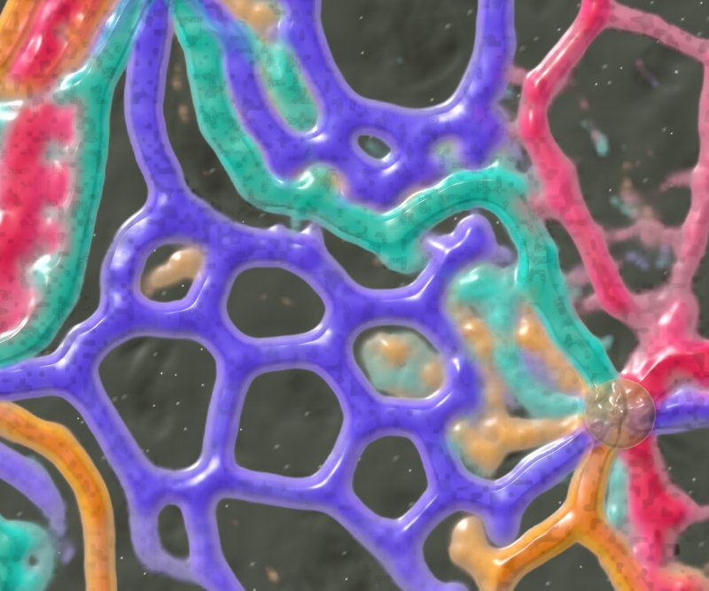
  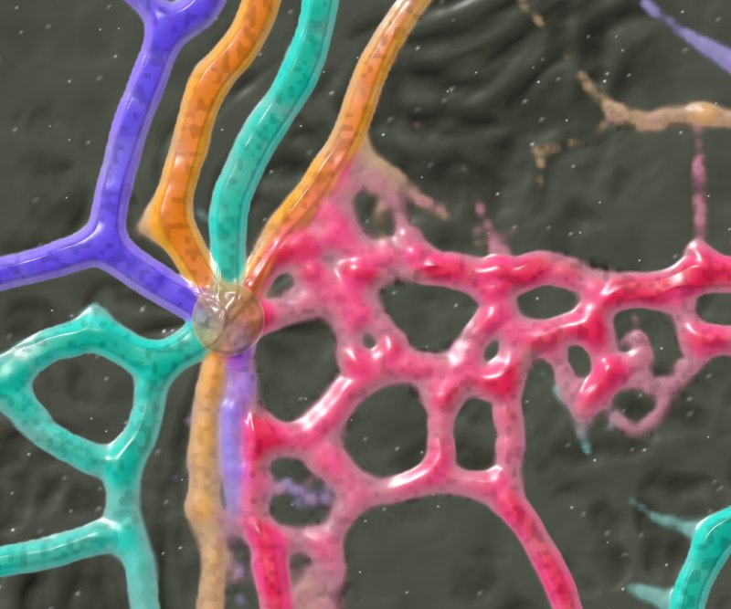
  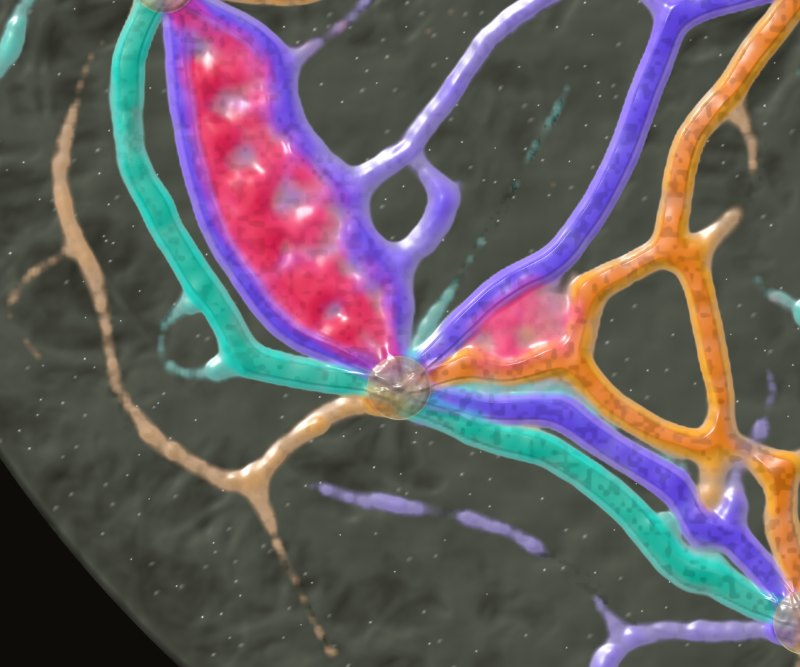
  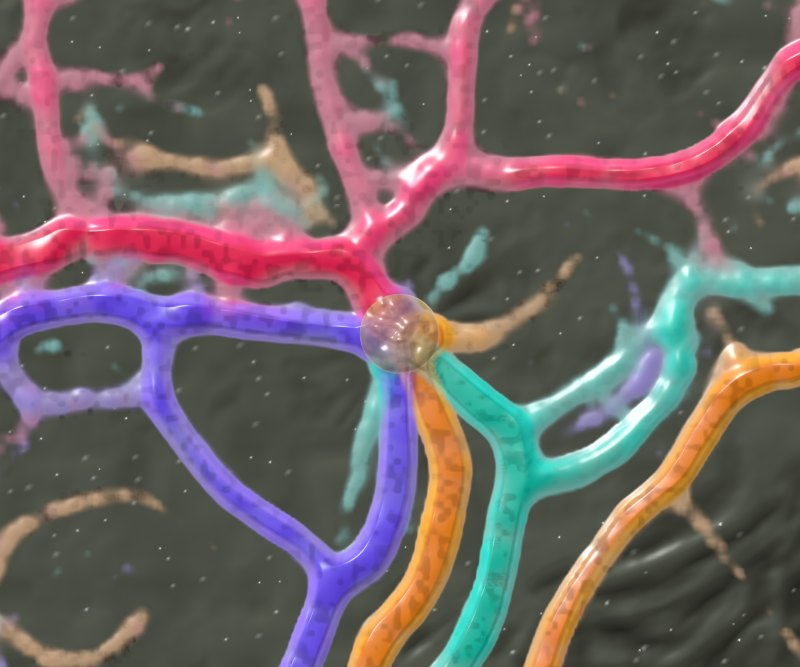
  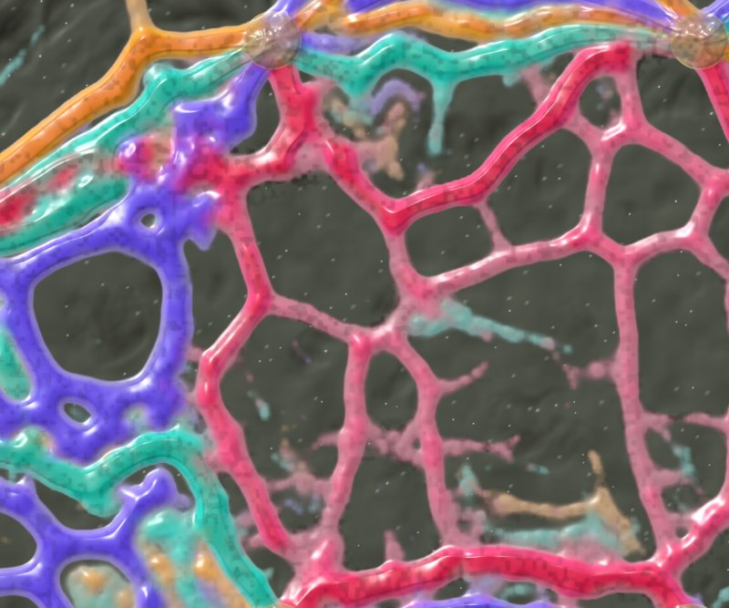
  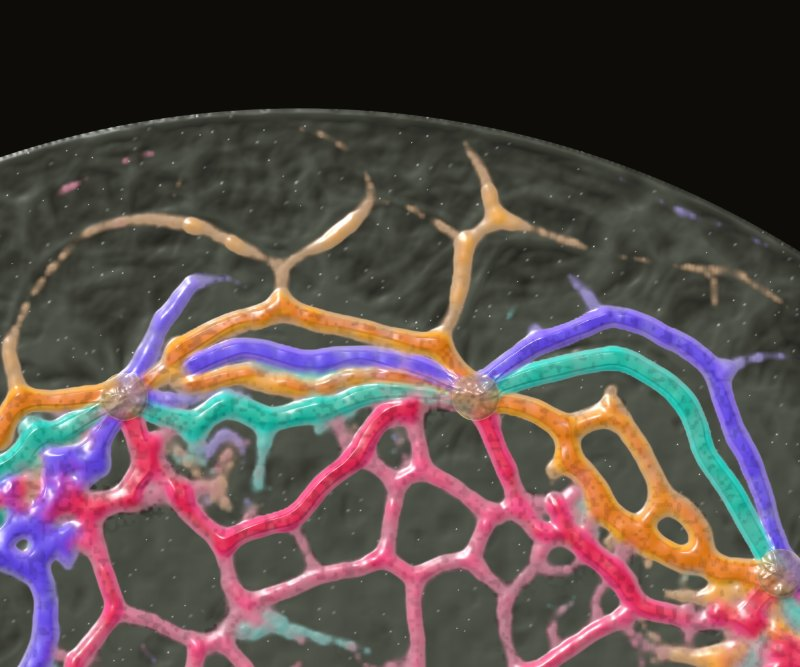
</p>

## More scenes

The Steiner tree of Jones (2010), Fig. 19, in the Gel style, seed 6: a loose network around four
foods contracts to a short tree, two junctions joined by a bridge. Steps 500, 2,000 and 12,000:

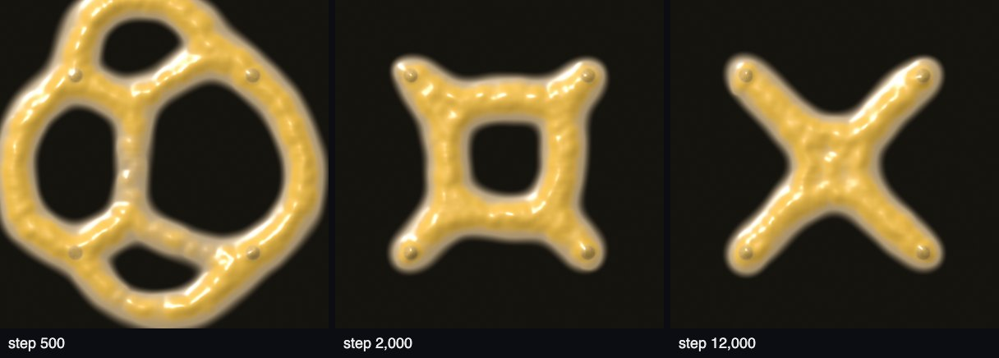

The Maze at step 5,000, without and with the flow in the tubes. With the flow, the route between
the two foods is one thick tube, and the stubs of the dead ends are thin:

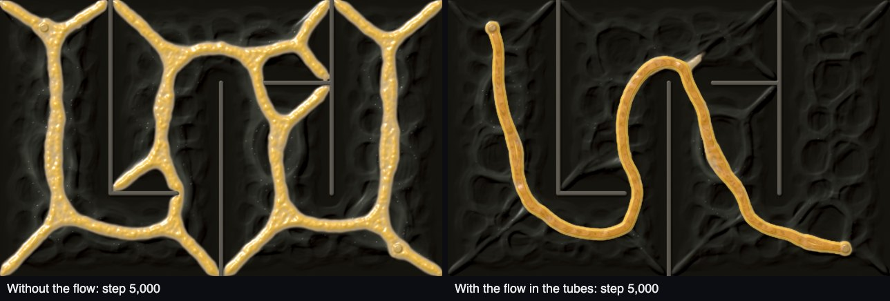

The Tokyo rail network at step 1,000 and at step 48,000, which stands for the 26 hours of the
experiment of Tero et al. (2010). At step 1,000 every tube is new, and a new tube is thick. At
step 48,000 the tubes that keep much flow are thick, the others are thin, and the film of slime
shows where the colony was:

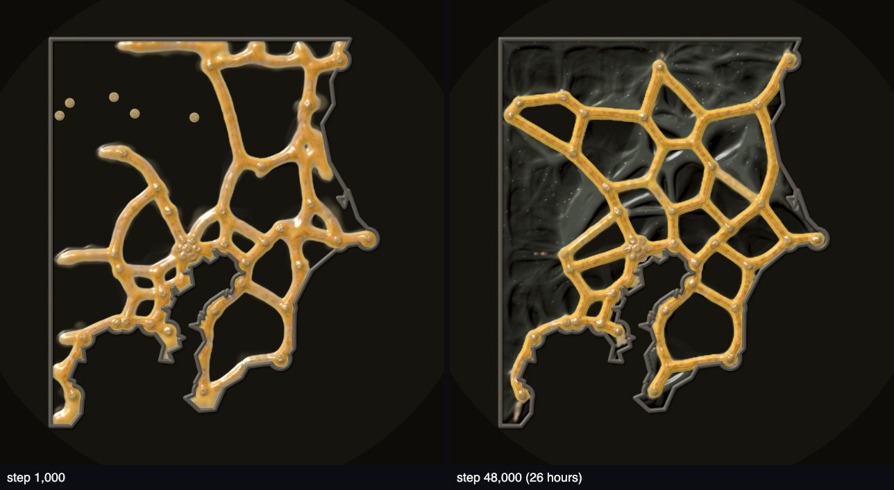

Cyclones, one of Michael Fogleman's saved settings for two species, on a grid of 2,048 cells on
its long side: one strain builds large cells, and the other spins vortices inside them.

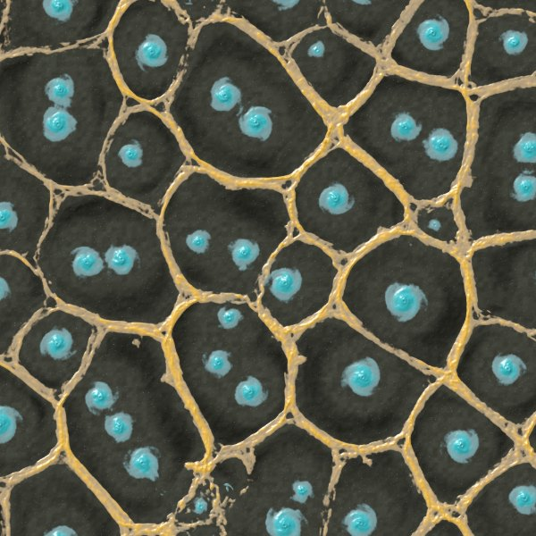

The pictures are snapshots of the app's own renderer, taken by
[`tests/pictures/readme.spec.ts`](tests/pictures/readme.spec.ts) at 3,200 × 2,000 pixels and
scaled down. It names the scene, the settings on top, the seed, the step and the view of each.

## How it works

Each agent has three forward sensors. In every step all agents sense the trail and turn toward
the strongest sensor (Jones' rule), move and deposit trail, then the trail spreads to neighbor
cells and decays. The scenes of Jones 2010 move first and sense after, as that paper orders a
step. Strong trails attract more agents, which strengthen the trail: a network forms.

- Simulation: WebGPU compute shaders (WGSL) with integer atomics; deterministic for a seed.
  Optional one-agent-per-cell rule as in the paper, with a deterministic GPU claim method.
- Flow in the tubes (optional, extended model): a pressure field on the grid after Tero,
  Kobayashi and Nakagaki (2007), solved by 16 local passes per step
  ([ADR 0029](docs/adr/0029-flow-in-the-tubes.md)).
- Growth front (optional, extended model with growth and the flow): a territory for each strain,
  sinks of the flow at its edge, and births that the flux pays
  ([model, 6.10, 6.11, 8.7 and 9.1](docs/model.md#610-the-territory-of-each-strain)).
- Fallback: a WebGL2 backend with the same model for browsers without WebGPU.
- Rendering: auto levels from a GPU histogram, glow (bloom), dithering against banding. Food
  and walls keep smooth outlines at any zoom: the brush also stores distances to their outlines,
  which only the renderer reads.

Details: [the rules of the model](docs/model.md) (the step, its formulas and every parameter),
[fidelity](docs/fidelity.md) (how close each behaviour comes to the real slime mold, with sources),
[design](docs/design.md), [decisions (ADRs)](docs/adr/),
[knowledge base](docs/knowledge-base/) (paper notes, variants, GPU and GitHub Pages facts), and
[research](research/flow/README.md) (the prototype, the measure scripts and the logs behind the
flow in the tubes, with a command for each step).

## Browser support

WebGPU in current Chrome, Edge, Safari 26+ and Firefox (Windows, Apple Silicon macOS). Other
browsers with WebGL2 (for example Firefox on Linux) use the fallback automatically. Force it
with `?backend=webgl2`.

## Keyboard

Space play/pause · `.` single step · R reset · 1–9 tools · `[` `]` brush size · F fit view ·
S scent view · H hide panels · L learn

Shift and two clicks paint a straight line with Food, Light, Wall, Erase, Electrode or Slime. While Shift is held, each further click
adds a line from the last end. Escape or letting go of Shift stops the line.

## Development

Requires Node 26 and npm 11.10 or later. Dependencies install without lifecycle scripts and
only after they are 3 days old (`.npmrc`).

```bash
npm ci
npx playwright install chromium
npm run dev          # http://localhost:5173
npm run verify       # lint, svelte-check, unit, GPU, build, e2e
npm run gallery      # renders every preset to test-results/gallery/
npx playwright test --project=pictures tests/pictures/readme.spec.ts  # the pictures of this README, after a build
pre-commit install   # hooks for commit and push
```

Tests:

| Command            | What                                                                                                                                             |
| ------------------ | ------------------------------------------------------------------------------------------------------------------------------------------------ |
| `npm test`         | unit tests (parameters, presets and their texts, URL parsing with fuzzing, packing, colors, levels), and the research scripts against their logs |
| `npm run test:gpu` | shaders compile; every model rule on **both** backends, mass balance, determinism, Fig. 10                                                       |
| `npm run test:e2e` | the built app in Chromium: boot, WebGL2 fallback, tools, presets, keyboard, axe a11y scan                                                        |

GPU tests use the real GPU locally and SwiftShader on GPU-less CI.

[`AGENTS.md`](AGENTS.md) is the short guide for coding agents and contributors: where things are, the rules of a
change, and the commands. The decisions and their reasons are in [`docs/adr/`](docs/adr/).

## Deployment

GitHub Actions builds, tests and deploys to GitHub Pages from `main`
([ADR 0018](docs/adr/0018-hosting-at-github-io.md)). One-time repository settings are in
`scripts/github-setup.sh`; Renovate needs a GitHub App ([ADR 0015](docs/adr/0015-renovate.md)).

## Credits

- Model: J. Jones, _Characteristics of Pattern Formation and Evolution in Approximations of
  Physarum Transport Networks_, Artificial Life 16(2): 127–153, 2010,
  [doi:10.1162/artl.2010.16.2.16202](https://doi.org/10.1162/artl.2010.16.2.16202)
  ([free PDF](https://web.archive.org/web/20260923011704/https://uwe-repository.worktribe.com/preview/980585/artl.2010.16.2.pdf)).
- GPU approach and inspiration: [Sage Jenson](https://cargocollective.com/sagejenson/physarum).
- Multiple species and the presets Cyclones, Dunes and Dot grid:
  [Michael Fogleman](https://github.com/fogleman/physarum) (MIT).
- Flow in the tubes: A. Tero, R. Kobayashi, T. Nakagaki, _A mathematical model for adaptive
  transport network in path finding by true slime mold_, J. Theor. Biol. 244: 553–564, 2007;
  A. Tero et al., _Rules for biologically inspired adaptive network design_, Science 327:
  439–442, 2010.
- Map of the Tokyo scenes (`src/model/tokyo.ts`): coastline and Lake Kasumigaura ©
  [OpenStreetMap](https://www.openstreetmap.org/copyright) contributors, Open Database License;
  station positions from Wikidata (CC0); the elevations behind the light on the mountains from
  SRTM (NASA and USGS, public domain).

## License

[MIT](LICENSE)
