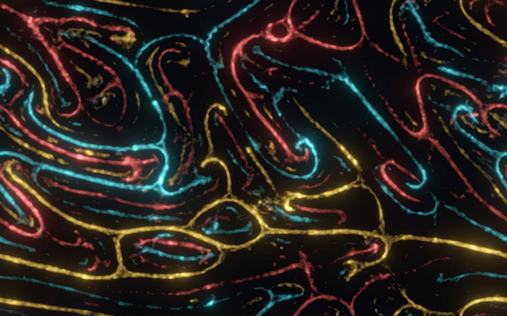
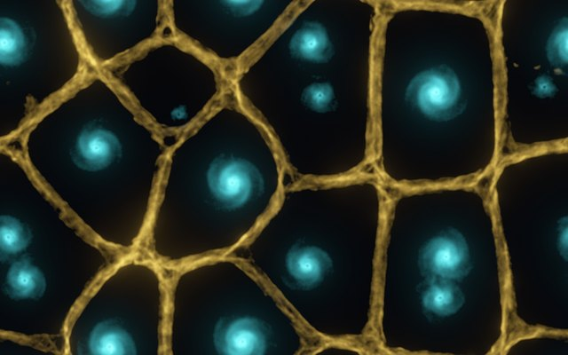
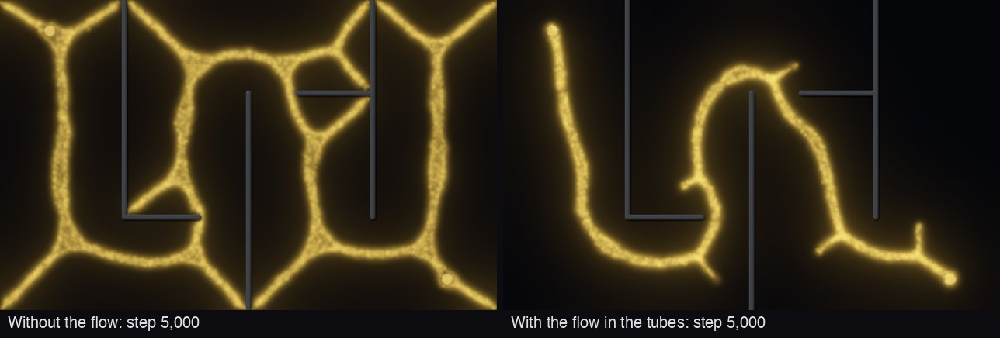
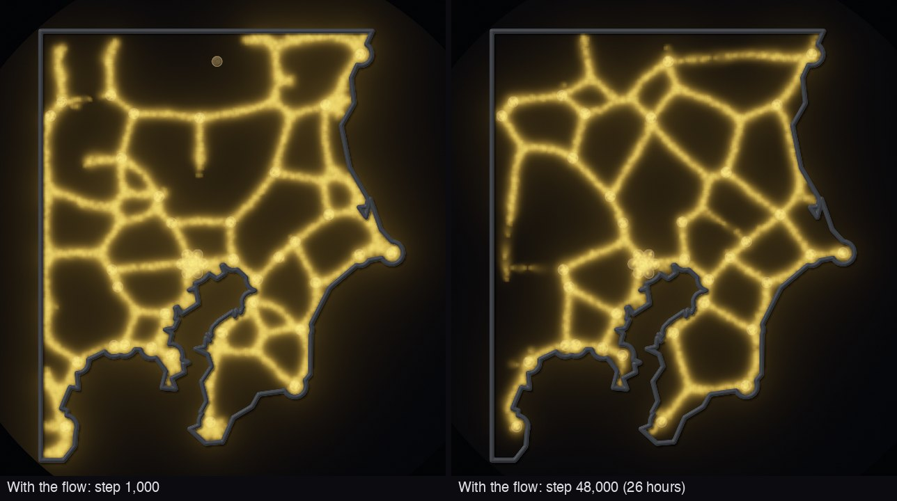

# Physarum: a slime mold simulator for the browser

An interactive simulation of the slime mold _Physarum polycephalum_. Millions of simple agents
leave trails and follow them, and transport networks appear: they connect food, flee light,
shrink, heal and compete. Everything runs on your graphics card, in the browser.



**Live:** <https://karstensiemer.github.io/physarum-slime-mold/>

## What you can do

- Place up to **four strains** side by side, give each a color and its own behaviour, and set
  how strongly each strain follows or flees the others.
- Change every parameter of the Jones (2010) model live: sensor angle, sensor distance,
  rotation angle, step size, deposit, decay, random turns, population, diffusion.
- Paint **food** (attracts), **light** (repels), **walls**, inoculate agents, or **cut** a
  wound and watch it heal.
- Run **experiments**: shortest path, Steiner tree, shrinking plasmodium and wound healing from
  the paper, plus light avoidance, a maze and the Tokyo rail network of Tero et al. (2010).
- Turn on **flow in the tubes**: tubes that carry flow between foods stay, the others starve.
  The Maze then keeps one tube along a short route. The picture draws every tube as wide as its
  flow memory says: a tube that keeps much flow stays thick, the others get thin and faint. Small
  grains move back and forth in each tube with the flow.
- Read what each scene shows: where its settings come from, what to watch, and why it uses them.
- Switch looks (glow, gel relief, paper, agents), pan and zoom, save a PNG, share the settings,
  the scene and its food, light and walls as a link.
- Learn: the biology, the paper behind the model and its six steps, every control and every
  scene, with references.

| Steiner tree (Jones 2010, Fig. 19)       | Cyclones (Fogleman's two-species preset) |
| ---------------------------------------- | ---------------------------------------- |
|  |     |

The Maze at step 5,000, without and with the flow in the tubes. With the flow, the route between
the two foods is one thick tube, and the stubs of the dead ends are thin:



The Tokyo rail network at step 1,000 and at step 48,000, which stands for the 26 hours of the
experiment of Tero et al. (2010). At step 1,000 every tube is new, and a new tube is thick. At
step 48,000 the tubes that keep much flow are thick, and the others are thin:



## How it works

Each agent has three forward sensors. In every step all agents sense the trail and turn toward
the strongest sensor (Jones' rule), move and deposit trail, then the trail spreads to neighbor
cells and decays. The scenes of Jones 2010 move first and sense after, as that paper orders a
step. Strong trails attract more agents, which strengthen the trail: a network forms.

- Simulation: WebGPU compute shaders (WGSL) with integer atomics; deterministic for a seed.
  Optional one-agent-per-cell rule as in the paper, with a deterministic GPU claim method.
- Flow in the tubes (optional, extended model): a pressure field on the grid after Tero,
  Kobayashi and Nakagaki (2007), solved by 16 local passes per step
  ([ADR 0029](docs/adr/0029-flow-in-the-tubes.md)).
- Fallback: a WebGL2 backend with the same model for browsers without WebGPU.
- Rendering: auto levels from a GPU histogram, glow (bloom), dithering against banding. Food
  and walls keep smooth outlines at any zoom: the brush also stores distances to their outlines,
  which only the renderer reads.

Details: [the rules of the model](docs/model.md) (the step, its formulas and every parameter),
[fidelity](docs/fidelity.md) (how close each behaviour comes to the real slime mold, with sources),
[design](docs/design.md), [decisions (ADRs)](docs/adr/),
[knowledge base](docs/knowledge-base/) (paper notes, variants, GPU and GitHub Pages facts), and
[research](research/flow/README.md) (the prototype, the measure scripts and the logs behind the
flow in the tubes, with a command for each step).

## Browser support

WebGPU in current Chrome, Edge, Safari 26+ and Firefox (Windows, Apple Silicon macOS). Other
browsers with WebGL2 (for example Firefox on Linux) use the fallback automatically. Force it
with `?backend=webgl2`.

## Keyboard

Space play/pause · `.` single step · R reset · 1–7 tools · `[` `]` brush size · F fit view ·
H hide panels · L learn

## Development

Requires Node 26 and npm 11.10 or later. Dependencies install without lifecycle scripts and
only after they are 3 days old (`.npmrc`).

```bash
npm ci
npx playwright install chromium
npm run dev          # http://localhost:5173
npm run verify       # lint, svelte-check, unit, GPU, build, e2e
npm run gallery      # renders every preset to test-results/gallery/
pre-commit install   # hooks for commit and push
```

Tests:

| Command            | What                                                                                                                                             |
| ------------------ | ------------------------------------------------------------------------------------------------------------------------------------------------ |
| `npm test`         | unit tests (parameters, presets and their texts, URL parsing with fuzzing, packing, colors, levels), and the research scripts against their logs |
| `npm run test:gpu` | shaders compile; every model rule on **both** backends, mass balance, determinism, Fig. 10                                                       |
| `npm run test:e2e` | the built app in Chromium: boot, WebGL2 fallback, tools, presets, keyboard, axe a11y scan                                                        |

GPU tests use the real GPU locally and SwiftShader on GPU-less CI.

## Deployment

GitHub Actions builds, tests and deploys to GitHub Pages from `main`
([ADR 0018](docs/adr/0018-hosting-at-github-io.md)). One-time repository settings are in
`scripts/github-setup.sh`; Renovate needs a GitHub App ([ADR 0015](docs/adr/0015-renovate.md)).

## Credits

- Model: J. Jones, _Characteristics of Pattern Formation and Evolution in Approximations of
  Physarum Transport Networks_, Artificial Life 16(2): 127–153, 2010,
  [doi:10.1162/artl.2010.16.2.16202](https://doi.org/10.1162/artl.2010.16.2.16202).
- GPU approach and inspiration: [Sage Jenson](https://cargocollective.com/sagejenson/physarum).
- Multiple species and the presets Cyclones, Dunes and Dot grid:
  [Michael Fogleman](https://github.com/fogleman/physarum) (MIT).
- Flow in the tubes: A. Tero, R. Kobayashi, T. Nakagaki, _A mathematical model for adaptive
  transport network in path finding by true slime mold_, J. Theor. Biol. 244: 553–564, 2007;
  A. Tero et al., _Rules for biologically inspired adaptive network design_, Science 327:
  439–442, 2010.
- Map of the scene Tokyo rail network (`src/model/tokyo.ts`): coastline ©
  [OpenStreetMap](https://www.openstreetmap.org/copyright) contributors, Open Database License;
  station positions from Wikidata (CC0).

## License

[MIT](LICENSE)
