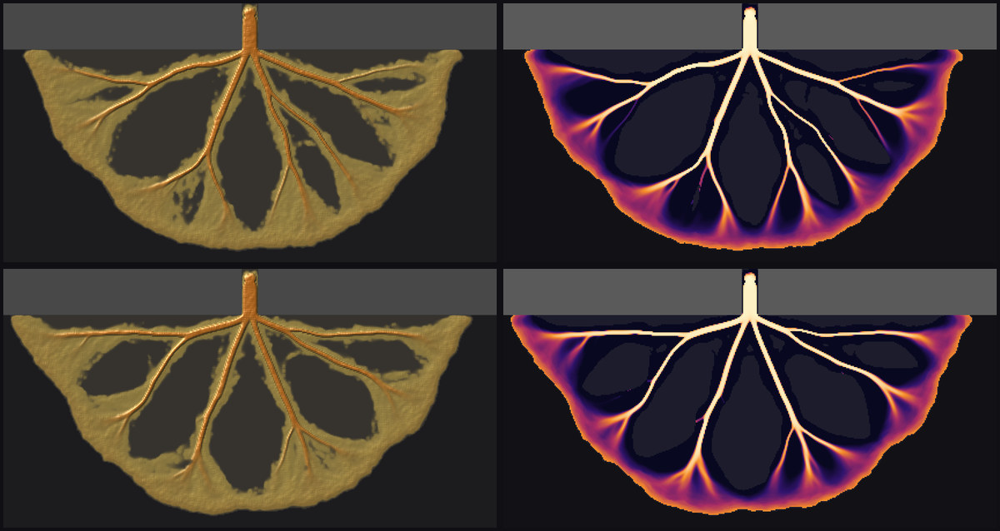
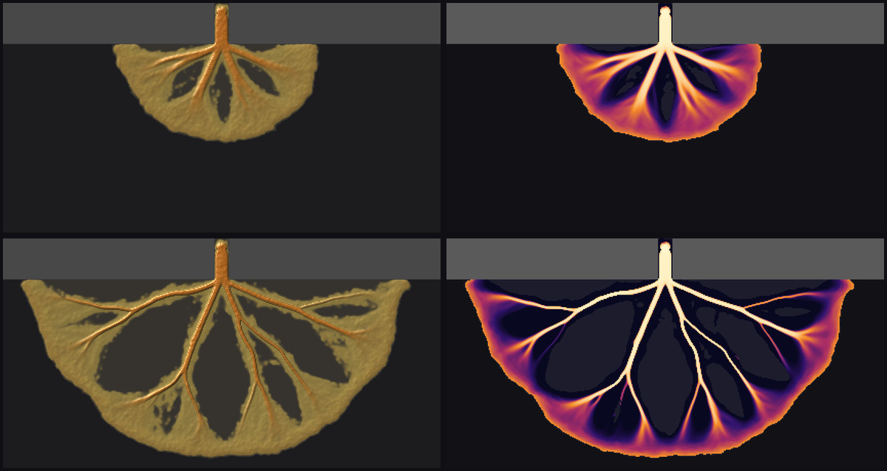
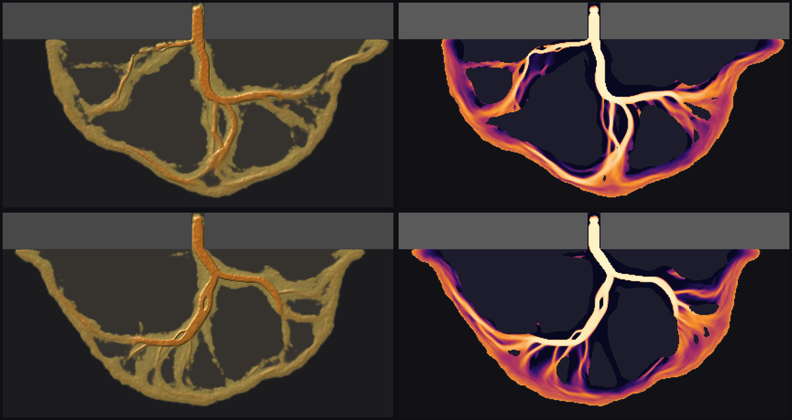
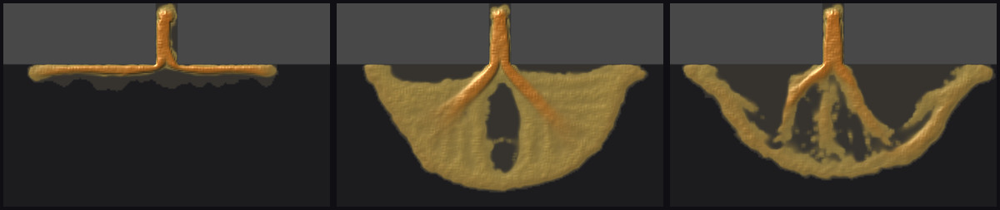

# 0085: The crown so far

- Status: accepted. Decided by the owner on 2026-11-21: the crown research of stage 4 pauses with the best form so
  far. This ADR records the state with pictures, what the coordinator assumes is missing, and how the coordinator
  would go on. The coordinator asked an agent to write it.
- Date: 2026-11-21
- Extends [ADR 0084](0084-a-front-that-splits-into-crowns-that-move-on.md) (part E2n, the best form) and
  [ADR 0076](0076-the-crown-at-the-head-of-a-tube.md) (part E2f, the start of the crown research).
- The story of all parts is on one page:
  [`research/front/the-crown-at-the-head.md`](../../research/front/the-crown-at-the-head.md). The raw records of each
  part are in the archive, in the folder that its ADR names.

## Context

The owner wants a crown at the head of a tube (ADR 0060, decision 14). The owner's definition is in `TODO.md`, in the
handover of stage 4 ("What the organism does"): a whole sheet of plasm with a lobed rim that moves ahead of the tube;
veins in it that run toward the rim and fork there, finer and finer; the crown moves on and leaves the veins behind;
the strong veins stay and become the tube, the fine ones go; the veins advance in a zigzag, like lightning, and line
up with the direction of the flow.

Nine parts of research on the CPU prototype (E2f to E2n, ADR 0076 to 0084, all of 2026-11-20) came closer to it, but no
run made a crown. The owner wrote on 2026-11-21: "Ja, das reicht erstmal. Aktuellen Stand dokumentieren, auch mit
Fotos der Kronen im ADR. Auch mit deiner Vermutung was jetzt noch fehlt und wie du weiter machen würdest." That is:
enough for now; record the state, with pictures of the crowns, the guess of what is still missing, and how to go on.

## The parts

Every part uses the neck: a channel 14 cells wide with the food at its closed end, which opens onto open ground. The
colony grows from the food; the still sheet of E2i to E2k is a fixed half disc at the mouth of the channel. k is the
flux of the front against E2f: the sinks take k times the flux of E2f together (`norm=2k paid=20k`).

1. **E2f** ([ADR 0076](0076-the-crown-at-the-head-of-a-tube.md)): the rules form no crown. Drift 0 gives a tree, drift
   1.25 to 5 a sheet (50 of 50 runs). Jones' births only near the edge of the territory (`jones=edge`) give a band at
   the rim and tubes on bare ground, with the veins near the head along the rim.
2. **E2g** ([ADR 0077](0077-a-sink-whose-share-follows-its-supply.md)): a sink whose share follows its supply
   (`shareOn=supply`) gives sheets with one smooth rim and no vein that forks there (8 runs). Such sinks level the
   pressure along the rim (measured in ADR 0078).
3. **E2h** ([ADR 0078](0078-a-conductance-that-follows-the-thickness-of-the-plasm.md)): a tube body by the cube of the
   share of agents, so that thick plasm conducts far better than thin, gives small trees of thick arms (12 runs).
4. **E2i** ([ADR 0079](0079-veins-in-a-still-sheet.md)): in a still sheet without agents, with the sinks on its rim, the
   rule of the tubes forks veins toward the rim from k = 2 on. The two main veins form a V at ±45°.
5. **E2j** ([ADR 0080](0080-the-flux-of-a-cell-and-the-veins-at-45-degrees.md)): the V comes from the flux of a cell as
   the sum over its 4 edges, which reads a broad flow on a diagonal up to 1.41 times higher.
6. **E2k** ([ADR 0081](0081-a-flow-over-8-neighbours.md)): with a flow over 8 neighbours (`stencil=8`) the veins follow
   no direction of the grid, and the still sheet forks toward the rim at k = 4.
7. **E2l** ([ADR 0082](0082-the-growing-colony-with-a-flow-over-8-neighbours.md)): the growing colony with 8 edges forms
   no crown (20 runs). Its rim holds 420 to 700 sinks, so each takes 0.03 to 0.15, too little: the still sheet forks
   at 0.26 per sink.
8. **E2m** ([ADR 0083](0083-more-flux-for-the-veins-of-the-growing-colony.md)): k = 16 saturates D, one thick sheet. The
   base conductance 0.002 instead of 0.02 (a diagnostic) at k = 2 and 4 gives 5 to 6 main veins that fork toward the
   rim, but in one half disc with one smooth rim.
9. **E2n** ([ADR 0084](0084-a-front-that-splits-into-crowns-that-move-on.md)), to step 16,000: the rim splits in no run
   (8 runs). A sink only on a cell whose D lets a vein grow (`sinkOn=fed`) changes nothing; Jones' births only on young
   ground (`jones=young`) give a crescent.

## The best form so far

E2n, case `none` (both options off, row 1 of ADR 0084), at step 16,000. The settings are the lines `RULES` and `BIG` of
`research/front/e2n.sh` with `jones=all`: the neck in a box of 520 × 340 cells, 8 edges, the base conductance 0.002,
k = 2 (`norm=4 paid=40`), equal shares, the drift `take` with the weight 1.5. One seed again (a run took about 21 min
in the campaign of ADR 0084, 9 runs on 6 cores):

```sh
node --import ./research/flow/register.mjs research/front/crowns.ts layout=neck every=1000 speed=0.004 speedOn=push \
  reach=6 rim=1 colony=1 slimeWeight=0.025 paidOn=sinks sinkAt=edge solver=app paidBy=rank fresh=box sums=fixed \
  sinkTube=1 scent=0 driftOn=take drift=1.5 stencil=8 norm=4 paid=40 base=0.002 side=520 long=340 steps=16000 \
  pics=8000,16000 dump=8000,12000,16000 jones=all seeds=1-1 name=crown/none/s1
```

The look is then `research/front/out/crown/none/s1-pics/s1/look-16000.png`.
`node --import ./research/flow/register.mjs research/front/e2l.ts pics=research/front/out/crown at=16000` draws D
beside it. The coordinator chose this case as the best form. It has the veins of a crown in one sheet; `jones=young`
(picture 3) comes closer to a crown that moves on and leaves tubes behind (ADR 0084), but keeps only a thin band of
sheet at the rim.

What it shows of the owner's crown, in seeds 1 and 2 (the numbers without a source come from the archived measures of
ADR 0084, `logs/engine/crown-0084/measures/`):

- One sheet at the head of the tube, far wider than the tube: a half disc at the mouth of the neck. It reaches 209 and
  210 cells from the food and is about 380 and 400 cells wide (read from the pictures).
- Main veins that leave the neck, run toward the rim and fork there: the parts of veins on the arcs around the mouth
  rise from 4 at the radius 20 to 11 at the radius 150. They run toward the rim: |cos| 0.73 to 0.90 (0.64 at random).
  The flow runs from the neck to the rim, so they line up with it (not measured against the flow itself).
- A band of plasm at the rim: the first veins lie 23 and 22 cells behind the rim (the 10th percentile of the distance
  of the vein cells, ADR 0084), and agents sit on 0.47 and 0.48 of the cells off the veins within 10 cells of it.
- The ground between the veins thins out: agents sit on 0.18 and 0.17 of the cells off the veins at 10 to 20 cells
  behind the rim, on 0.07 and 0.06 at 20 to 40 cells (ADR 0084), and on 0.03 at 40 to 80 cells.
- In part, fine veins that go. Between the steps 8,000 and 16,000 the forks at the rim of step 8,000 went: on the arcs
  at the radius 60 and 75 the parts of veins with D of 0.01 and more fell from 9 or 10 to 5 or 6, and the share of the
  arc with a tube body fell from between 0.85 and 0.99 to between 0.39 and 0.49. The main veins stayed (picture 2).

What it lacks:

- Lobes: the rim is one smooth arc. Not measured: how far the radius of the rim varies by angle.
- A split into several crowns: one head. The whole rim, 746 and 752 cells, advances, and no part of it stands (ADR
  0084). In the organism a front splits in two, and one of the two stops (Kuroda et al. 2015, p. 3736).
- A crown that moves on as a sheet ahead of its tube: the whole half disc stays and grows around the neck. Its rim
  grows from 402 and 408 cells at step 8,000 to 746 and 752 at step 16,000, and no tube grows out of it with a crown of
  its own. So the fine veins go only inside this one sheet, not behind a crown that moved on.
- Veins that advance in a zigzag: the veins run in smooth curves (by eye; the zigzag is not measured).

## Pictures

Each picture is cut from the run pictures in `research/front/out/` (git ignores them; 3 pixels per cell), scaled to
the width of its column, padded by 4 pixels of 0x101014 as `research/front/crown-montage.sh` pads, and saved as a JPG
of quality 88 to 90. The frames: for E2n x 140 to 1,420 and y 0 to 672 of its pictures of 1,560 × 1,020 pixels; for
E2f x 70 to 710 and y 0 to 400 of the pictures of 780 × 480 pixels in `out/e2f/montage/forms-look-8000-s1.png`; for
the still sheet the whole pictures in `out/e2k/montage/d-16000-s1.png` (its rows k = 1, 2, 4; its columns 4 edges, 4
edges with `fluxOn=norm`, 8 edges).

In the pictures of D the colour shows log10 D on the tube body from −3 (dark) to 0 (pale yellow); orange is about
0.2, the fresh D of a cell that the front reaches. Ground that the front reached without a tube body is dark blue, the
walls are grey.



**Picture 1, the best form so far.** E2n (ADR 0084), case `none`, step 16,000: seed 1 above, seed 2 below; the look on
the left, D on the right. The grey wall at the top holds the neck with the tube from the food. To see: one half disc
at the head of the tube; main veins from the neck that fork toward the rim; a band of plasm at the rim without veins;
bare ground between the veins; one smooth rim, orange in D all along it.



**Picture 2, its growth.** E2n, case `none`, seed 1, step 8,000 above and step 16,000 below, in the same frame; the
look on the left, D on the right. To see: the whole rim advances; the main veins of step 8,000 stay and grow longer;
the forks at the rim of step 8,000 have gone by step 16,000, and new forks lie at the new rim.



**Picture 3, the crescent.** E2n, case `young` (Jones' births only on ground that the front reached less than 1,500
steps before), step 16,000: seed 1 above, seed 2 below; the look on the left, D on the right. To see: a band of sheet
at the rim with veins toward the rim, fed by 1 to 3 thick tubes, and bare ground behind; still one arc without lobes.



**Picture 4, earlier forms.** E2f (ADR 0076), the rules with 4 edges and the base 0.02, k = 1, seed 1, step 8,000,
the look. From the left: drift 0, a tree (two arms along the wall); drift 1.5, a sheet with a V of two veins; drift
1.5 with `jones=edge`, a band at the rim and tubes on bare ground.


**Picture 5, veins in a still sheet.** E2i and E2k (ADR 0079 and 0081): a fixed half disc of radius 80 cells without
agents, the sinks on its rim with equal shares, the base 0.02, seed 1, step 16,000, D. From the left: 4 edges at k = 2,
the V at ±45° with forks toward the rim; 8 edges at k = 2, four straight rays; 8 edges at k = 4, a tree that forks
toward the rim and follows no direction of the grid.

## What is missing: the coordinator's guess

The coordinator assumes that the rim conducts too well along itself, because a cell that the front reaches starts with
a fresh conductance. The reasons:

1. A cell that the front reaches starts with the fresh conductance D = 0.2 (`docs/model.md`, 8.1 and 8.4; ADR 0084).
   At the base 0.002 a vein grows only above D = base / (γ − 1) = 0.0025, with γ = 1.8 (the growth rate of a vein in
   a sheet: `research/front/the-crown-at-the-head.md`, "What the rules lack", point 3). So the fresh D is 80 times that
   threshold. Then the whole band at the rim conducts like a tube. It levels the pressure along the rim, every part of
   the rim gets about the same flux, and the rim advances as one smooth arc. With equal shares every sink takes the
   same by the rule; a sink whose share follows its supply takes about the same where the pressure is level (ADR
   0078). That is also why `sinkOn=fed` found every rim cell fed (ADR 0084).
2. The shape alone makes no lobes: a bump of the rim lies farther from the source behind it and gets less flux. Lobes
   must come from the veins: the part of the rim that a strong vein feeds must advance faster than the parts between
   the veins. For that the rim must not conduct sideways, so its conductance must come from the veins, not from a
   fresh level. This reasoning is not measured.
3. Less sure: the real organism has a shuttle flow, much stronger than its net flow. That is an assumption: no source
   gives the ratio as a number (ADR 0083 lists the sources). The model has only the net flow. More net flux saturated
   D (k = 16, ADR 0083); a shuttle flow could grow veins without moving more plasm.

The records of ADR 0084 fit reason 1, but do not test it. At step 16,000 the tube body on ground that the front reached
200 to 800 steps before still holds a mean D of 0.070 in both seeds, 28 times the threshold, and in picture 1 the band
at the rim is orange in D. The pressure at the sinks spreads by 0.10 of the drop from the food in both seeds (the 10th
to the 90th percentile, the measure of ADR 0078), and by 0.47 and 0.27 with `jones=young`, whose band is thin.

## How the coordinator would go on

1. **E2o**, about 200,000 tokens of a helper. In the box of E2n with 8 edges, the base 0.002 and k = 2, a cell that the
   front reaches starts at the base level (D = 0.002) instead of D = 0.2; with `sinkOn=fed`, with `shareOn=supply`, and
   with `jones=young`. Measure whether the rim splits into heads (the head count of ADR 0084), how far the radius of
   the rim varies by angle (lobes), and whether the veins run toward the rim.
2. If the rim splits: pictures to the owner first, then the rule into the engine.
3. If it does not: an isolating study of the rim (a still band with one given vein: does the part of the rim at the
   vein advance faster?), then a shuttle flow as an option (a pressure at the source that swings).
4. The zigzag of the veins is not studied yet.

Parallel work of 2026-11-21 takes the next steps in the engine: ADR 0086 brings the flow over 8 neighbours, the base
conductance and the flux of the front into the engine as settings, and ADR 0087 adds a crown scene and its panel
controls.

## The cost

The crown research used about 2.33 million tokens of helpers (the coordinator's count): E2f 637,000, E2g 204,000, E2h
186,000, E2i 243,000, E2j 218,000, E2k 213,000, E2l 204,000, E2m 195,000, E2n 230,000.

## Decision

The owner's: the crown research of stage 4 pauses with the best form so far, E2n with both options off. This ADR
changes no rule, code or test. The options of the prototype stay off by default, and every record stays as it was.

## Consequences

- The crown of ADR 0060 (decision 14) is not reached. The best form has the veins of a crown, but not its rim and not
  its motion.
- The guess of what is missing is not measured. E2o tests its first reason; it is the next step when the research goes
  on.
- Not measured: more than 2 seeds per case, the radius of the rim by angle, the zigzag, the delay of the main vein
  behind the front, and all of it in the engine.
