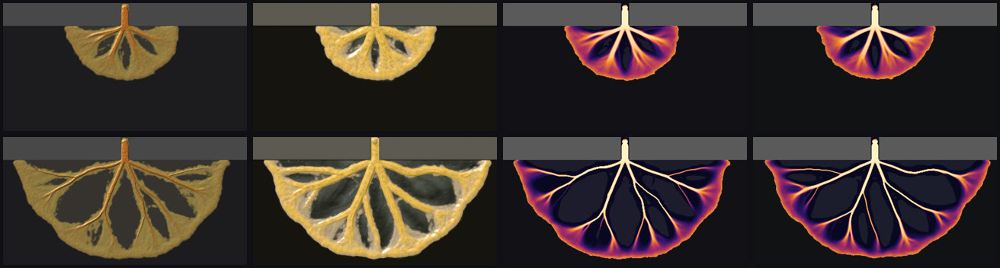

# 0087: The crown as a scene, with its levers in the panel

- Status: accepted. The owner asked on 2026-11-21 that the best crown form of the prototype can be made in the app,
  "mindestens eine neue Szene und das Verhalten einstellbar" (at least one new scene, and the behaviour adjustable).
  The coordinator set the task on the same day, part E5b of stage 4: the scene, its comparison with the prototype, the
  panel controls, the tests and the time of a step. Decisions 1, 3 and 4 and the order of the work are the
  coordinator's; the other choices are an agent's. Both under the owner's delegation of 2026-11-12.
- Date: 2026-11-21
- Extends [ADR 0085](0085-the-crown-so-far.md) (the best form so far, now a scene),
  [ADR 0086](0086-three-levers-of-the-crown-as-settings.md) (its levers, now in the panel and in Learn) and
  [ADR 0076](0076-the-crown-at-the-head-of-a-tube.md) (finding 3: what the drift gives, now in its help).
- In short: [`research/front/ENGINE.md`](../../research/front/ENGINE.md) has the part E5b;
  [`research/flow/README.md`](../../research/flow/README.md), part 34, has the checks and their commands. The records
  are in the archive under `logs/engine/crown-scene-0087/`.

## Context

The best crown form of the prototype is the case `none` of `research/front/e2n.sh` (ADR 0084, ADR 0085): a colony
grows out of a narrow neck as one half disc with a few main veins that fork toward its rim. The rules of stage 4 are in
the engine behind the setting `territory` (ADR 0068 to ADR 0075), and its three levers since ADR 0086 (`flowEdges`,
`flowBase`, `frontFlux`). No scene turned them on, and the panel showed none of them.

## Decisions

1. **A scene `crown`, "Crown of veins"** (the coordinator), in the group Experiments, source "Made for this app". Its
   texts say what it shows (the veins of a crown in one sheet) and what it lacks (a lobed rim, a crown that moves on
   ahead of its tube), as ADR 0085 does. It names no ADR and no prototype.
2. **The layout of the prototype, cell for cell.** The neck of `research/front/layouts.ts` (`neck()`) with the words
   of `crowns.ts`: a closed box of 520 × 340 cells on every screen (the lattice, as the Corn maze has one), its first
   40 rows wall but for a channel 14 cells wide (the columns 253 to 266), the food of radius 5 around (260, 8), the
   colony on the food (`CROWN` and `crownShapes()` in `src/model/presets.ts`). The 20,240 wall cells and the 80 food
   cells are those of `neck()` (`presets.test.ts`). A wall is a stroke, and the picture lights a wall by the distance
   to the outline of its strokes (`paint.wgsl`): a block of thin strokes, one per 3 rows, showed a rib per stroke. So
   each block is thick strokes of 8 cells, whose outline lies on the edges of the block, and two thin strokes fill the
   corner at the mouth that their round ends leave open. Every cell of a block lies at least 4 cells (the depth that
   the picture lights) inside one stroke, or as deep as inside the block, but in the two corners of 8 × 8 cells at the
   mouth, which look a little rounded. No cell lies within 0.05 cells of the edge of a stroke.
3. **The settings of the case `none`, word for word** (the coordinator: the lines `RULES` and `BIG` of `e2n.sh` with
   `jones=all`, and the agent of `params()` of `research/front/sim.ts`). The table below maps each word. Every word has
   its equal in the engine; two forms differ, as ADR 0067 and ADR 0069 decided, and the comparison below shows no
   effect of them. `forager()` gives the agent, so the scene has the settings of the Corn maze but for the lattice,
   the rules and the levers (`presets.test.ts`).
4. **The panel shows each control only where it acts** (the coordinator). In the Flow section, below Flow strength:
   the switch Flow over 8 neighbours and the slider Base conductance while the flow is on; the switch Rules of the
   growth front while growth (and so one agent per cell) is on too; and the sliders Drift and Flux to the front while
   the rules are on. Each has its help. A change of the neighbours, the base, the drift or the flux acts at the next
   step; a switch of the rules restarts the scene (ADR 0068). The link holds what it held (ADR 0086): a link of the
   scene opens it unchanged (`state.test.ts`).
5. **Learn lists them** in the order of the panel, after Flow strength. The help of the rules is new
   (`territoryHelp`); the help of the neighbours, the base and the flux to the front name the scene.
6. **The help of the drift says what the drift `take` gives** (ADR 0076, finding 3): 0 a tree, 1.25 to 5 a sheet at
   the head of a tube whose width the weight sets, and no crown that moves on. It said "1.25 to 1.5 a tube with a crown,
   and 5 a fan", the forms of the drift `all` of ADR 0065; ADR 0076 found them sheets with `take`, and its help waited
   for the owner. The owner paused the crown research with these rules (ADR 0085), so the help now says what they give.
7. **The notice of a switch to the Jones model names the rules** ("It removed the flow in the tubes and the rules of
   the growth front"), and skips the drift and the flux to the front as it skips the flow strength and the base:
   without the rules they mean nothing.
8. **The texts that said that no scene has the rules** now name the scene: `docs/model.md` (6.10, 6.11, 8.1, 8.7 and
   9.1), the comments of `params.ts`, `sim.ts` and `programs.ts`, and the tests that held every scene to the defaults
   (`params.test.ts`). No rule changes. The fit of the grids of ADR 0058 holds 31 scenes, 3,456 cases, and the scene
   keeps its grid in every case (`research/electrode/README.md`).

| The prototype (`e2n.sh`, case `none`)                                                                                                                                                                           | The engine                                                                                                                     |
| --------------------------------------------------------------------------------------------------------------------------------------------------------------------------------------------------------------- | ------------------------------------------------------------------------------------------------------------------------------ |
| `layout=neck side=520 long=340` (`neckWide` 14, `neckLong` 40)                                                                                                                                                  | `lattice` [520, 340], `boundary` box, `crownShapes()`, `layout` food (decision 2)                                              |
| `speed=0.004 speedOn=push`                                                                                                                                                                                      | the push, `TERRITORY.speed` 0.004 (`docs/model.md` 6.10)                                                                       |
| `reach=6 fresh=box`                                                                                                                                                                                             | `SINKS.fresh` 6; the engine follows paths over open cells, the prototype the square (ADR 0067, decision 10)                    |
| `sinkAt=edge`                                                                                                                                                                                                   | `SINKS.edge` 2, the edge of the territory (6.11), also over paths                                                              |
| `slimeWeight=0.025`                                                                                                                                                                                             | `SINKS.slime` 0.025                                                                                                            |
| `rim=1`                                                                                                                                                                                                         | an agent of the front lies at the rim, and its child goes out (9.1)                                                            |
| `colony=1`                                                                                                                                                                                                      | the colony pays while it covers no food (8.7)                                                                                  |
| `paidOn=sinks paidBy=rank sums=fixed`                                                                                                                                                                           | the paid births (9.1) and the sums of 6.11                                                                                     |
| `sinkTube=1`                                                                                                                                                                                                    | the tube of a sink (6.11, ADR 0072)                                                                                            |
| `solver=app`                                                                                                                                                                                                    | 16 iterations per step (8.3)                                                                                                   |
| `scent=0`                                                                                                                                                                                                       | the app starts without a food scent                                                                                            |
| `driftOn=take drift=1.5`                                                                                                                                                                                        | the drift `take` (8.7, ADR 0075), `drift` 1.5                                                                                  |
| `stencil=8`                                                                                                                                                                                                     | `flowEdges` 8                                                                                                                  |
| `base=0.002`                                                                                                                                                                                                    | `flowBase` 0.002                                                                                                               |
| `norm=4 paid=40`                                                                                                                                                                                                | `frontFlux` 2: S = 2 k · I0 = 4 · I0, one birth for 20 k = 40 of flux (ADR 0086, decision 8)                                   |
| `jones=all`                                                                                                                                                                                                     | Jones' births wherever the window allows them, the growth of every scene (section 9)                                           |
| the defaults of `noFront()` that act: `tau` 100, `start` disc, `bodyOn` trail, `sinkOn` all, `shareOn` equal, `fluxOn` sum, `refOn` roles                                                                       | `SINKS.tau` 100, the start territory (6.10), the tube body of 8.1, every sink with its weight, Q of 8.4, the zero point of 8.3 |
| `params()`: I0 8, slime life 144 h, sensor offset 7, angles 22.5° and 45°, step 1, deposit 5, decay 0.1, food weight 1, food strength 0.03, scent decay 0.1, covered 1, capacity 0.25 per cell, 50 start agents | `forager()`: the same values; `coveredFood` off; the start layout food places about 50 agents on a disc of about 100 cells     |
| `every`, `steps`, `pics`, `dump`                                                                                                                                                                                | the records of a run, no rule                                                                                                  |

## The comparison with the prototype

The engine runs the scene with `research/front/e5b-crown.gpu.test.ts` and saves the fields that the measures of the
crown read, in the format of the prototype; `research/front/e5b.ts` gives them the form of a campaign of `crowns.ts`,
and `e2n.ts` measures them as it measured the prototype. The engine counts the step that places the colony as its
first step: its step k + 1 is the prototype's step k.

**Both backends, seeds 1 to 6, to step 1,500** (the coordinator's rule after a gap of 2 that pass tests missed): the
means over the seeds, and the least and the most.

| Step 1,500      | Live agents      | Reach of the tube body (cells) | Territory (cells) | Sinks      |
| --------------- | ---------------- | ------------------------------ | ----------------- | ---------- |
| WebGPU          | 318 (297 to 337) | 36.0 (33.9 to 37.8)            | 606 (568 to 636)  | 31 (23–50) |
| WebGL2          | 316 (299 to 337) | 36.1 (34.7 to 38.2)            | 610 (582 to 648)  | 28 (13–38) |
| WebGL2 / WebGPU | 0.99             | 1.00                           | 1.01              | 0.92       |

The records of steps 500 and 1,000 agree as closely (ratios 0.98 to 1.02 but for the sinks, 0.86 to 1.04). The colony
leaves the neck at step 1,100 to 1,350 (its territory), 1,150 to 1,400 (its first agent below the neck) and 1,150 to
1,450 (its tube body), in 12 runs of both backends (records every 50 steps).

**The growth to step 16,000**, WebGPU seeds 1 and 2 and WebGL2 seed 1, against the prototype's seeds 1 and 2 (the
records of ADR 0084): live agents / reach in cells.

| Step   | Prototype s1 | Prototype s2 | WebGPU s1   | WebGPU s2   | WebGL2 s1   |
| ------ | ------------ | ------------ | ----------- | ----------- | ----------- |
| 2,000  | 476 / 45     | 477 / 46     | 506 / 46    | 505 / 48    | 482 / 44    |
| 4,000  | 1,634 / 82   | 1,512 / 80   | 1,572 / 79  | 1,567 / 80  | 1,569 / 79  |
| 8,000  | 4,078 / 128  | 3,906 / 128  | 3,950 / 129 | 4,015 / 130 | 4,022 / 126 |
| 12,000 | 5,803 / 172  | 5,772 / 170  | 5,763 / 169 | 5,960 / 171 | 5,934 / 168 |
| 16,000 | 7,328 / 209  | 7,235 / 210  | 7,207 / 209 | 7,223 / 210 | 7,471 / 214 |

**The measures of the crown** (ADR 0084, `e2n.ts`) at step 16,000; at step 8,000 they agree as closely:

| Step 16,000                                     | Prototype s1; s2                         | WebGPU s1; s2                            | WebGL2 s1           |
| ----------------------------------------------- | ---------------------------------------- | ---------------------------------------- | ------------------- |
| Form                                            | sheet; sheet                             | tubes; sheet                             | sheet               |
| Flux per rim sink                               | 0.030; 0.031                             | 0.030; 0.031                             | 0.031               |
| Heads (rim cells)                               | 1 (746); 1 (752)                         | 1 (753); 1 (753)                         | 1 (769)             |
| Off-vein agents 0–10, 10–20, 20–40, 40–80 cells | 0.47 0.18 0.07 0.03; 0.48 0.17 0.06 0.03 | 0.48 0.16 0.06 0.03; 0.48 0.17 0.06 0.03 | 0.48 0.19 0.07 0.03 |
| First veins behind the rim (cells)              | 23; 22                                   | 23; 22                                   | 22                  |
| Veins on the arcs at 20 to 170 cells            | 4 4 5 5 6 9 9 11 1; 4 5 6 6 6 7 8 11 1   | 4 4 5 7 7 8 9 11 1; 4 4 4 4 6 7 8 10 0   | 4 4 4 5 5 10 11 8 2 |

The form "tubes" of WebGPU seed 1 is the threshold of `form()` in `crown-table.ts`: a sheet needs agents on 0.08 of
the old ground, and that run has 0.079; the prototype's runs have 0.089 and 0.085, the engine's others 0.082 and
0.091. No measure lies outside the spread of the prototype's seeds by more than the engine's seeds spread among
themselves.

**The picture.** Seed 1, step 8,000 above and 16,000 below. From the left: the look of the prototype and the look of
the app (WebGPU, its default style), then D of the prototype and D of the engine, in the frame of the pictures of ADR
0085 (`bash research/front/e5b.sh montage`; the app's pictures come from `tests/pictures/crown.spec.ts`). To see: the
same half disc with main veins from the neck that fork toward the rim; at step 16,000 the forks of step 8,000 have
gone, and new ones lie at the new rim; one smooth rim. The two looks differ in their renderers, not in the colony.

## The time of a step

TIME

## Checks

CHECKS

## Not measured

- More than 2 seeds to step 16,000 on WebGPU and 1 on WebGL2; the scene on SwiftShader beyond the e2e test.
- The scene on a portrait screen, where the lattice turns, and on a device that cannot hold the lattice.
- The look in the styles glow and paper, and the look of the two corners of the mouth up close.
- What the drift, the base, the flux and the neighbours give in this scene at other values: the panel offers them, and
  only the values of the case `none` are measured here.
- Each strain with a drift of its own (ADR 0070, decision 5): the setting stays one value for all strains.
