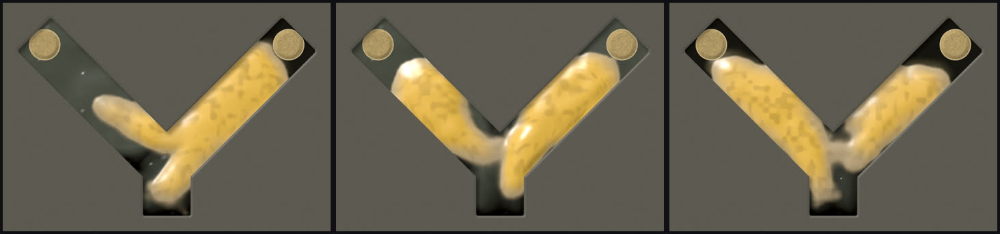
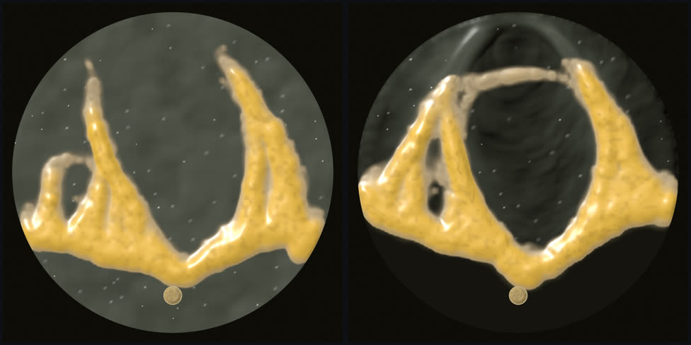

# 0088: The scenes of Reid et al. 2012 run the rules of the growth front, and the avoidance of slime is a setting

- Status: accepted. The owner wrote on 2026-11-21 "Ja, danach starten" (yes, start it after that: part E4 after the
  crown scene, which is merged in #136) and "Ich sehe auch noch keine Settings in der UI zur Schleimvermeidung, das
  muss da auch mit rein" (I see no settings in the UI for the avoidance of slime yet; they must go in too). The
  coordinator set the task on the same day: part E4 of stage 4. Decisions 1, 4, 5 and 6 are the coordinator's, and
  decision 2 answers a question of the coordinator; the other choices are an agent's. Both under the owner's
  delegation of 2026-11-12. Built 2026-11-21.
- Date: 2026-11-21
- Extends [ADR 0066](0066-two-scenes-of-reid-and-the-start-spot.md) (the two scenes now run the rules, and the Y-maze
  has its two controls), [ADR 0069](0069-the-sinks-of-each-strain-in-the-engine.md) (the weight on slime and the reach
  to ground without slime are settings now), [ADR 0070](0070-the-flow-takes-the-sinks-in-the-engine.md) (decision 5:
  the drift of these scenes) and [ADR 0073](0073-a-colony-with-the-rules-starts-as-the-app-starts.md) (the open
  point: the Y-maze without slime over 40 seeds in the engine).
- In short: [`research/front/ENGINE.md`](../../research/front/ENGINE.md) has the part E4;
  [`research/flow/README.md`](../../research/flow/README.md), part 35, has the checks and their commands. The records
  are in the archive under `logs/engine/reid-0088/`.

## Context

The rules of stage 4 are in the engine behind the setting `territory` (ADR 0068 to ADR 0075), and one scene ran them,
the Crown of veins (ADR 0087). The two scenes of Reid et al. 2012 (ADR 0066) ran without them: their texts said that
no rule reads the slime, and the Y-maze showed no avoidance. The sink of the rules has the weight 1 near ground without
slime and 0.025 elsewhere (the owner's decision of 2026-11-19, ADR 0065, decision 5), and ground without slime counts
within 6 steps (ADR 0067, decision 10). Both were constants of `src/engine/sinks.ts` (`SINKS.slime`, `SINKS.fresh`),
and the panel showed neither. The drift of the rules has a provisional default of 1.5, and ADR 0070, decision 5, left
the drift of each scene to this part.

Reid et al. 2012 (PNAS 109: 17490): with slime on one arm of a Y-maze, 39 of 40 plasmodia took the arm without slime;
with slime on both arms they showed no preference; on agar coated with slime they reached a well of glucose as fast as
on blank agar (n = 13 and 16). The prototype of stage 4 with the rules in force (the drift `take` at 1.5, the start of
the app, the tube of a sink; `research/flow/logs/engine/drift-0074/`, ADR 0074) gives 40 : 0, 18 : 22 with slime on
both arms (1.05 times as late as without slime), 15 : 24 and a split without slime, and half of an open dish after
5,882.5 steps.

## Decisions

1. **Two settings take the place of the two constants** (the coordinator): Weight on slime (`slimeWeight`, 0.025 by
   default) and Reach to fresh ground (`freshReach`, 6 by default, a whole number), one value for all strains, in
   `globalSpec` of `src/model/params.ts`. `slimeWeightOf()` and `freshReachOf()` of `sinks.ts` give them in the units
   of the passes, and `packSinks()` writes them into the lanes w and x of `FLOW_SINK_SLOT`, where the constants were.
   The passes of both backends read those lanes already, so no shader changes; the CPU copy reads them from its input
   (`SinkInput.slime`, `SinkInput.reach`). With the defaults the block holds the bytes of before, and every scene keeps
   its bytes (Checks). A weight of 1 is the weight near fresh ground: the slime then changes no sink. A change acts at
   the next step: both sims pack the block in every step.
2. **The least reach is 2 cells, the reach of the edge** (an agent's finding; the coordinator asked for it). Two
   reasons. The passes go on from the paths of the edge to the paths of the reach (`sinks.wgsl`, `sinks.frag`), so a
   reach below 2 would need paths of its own. And below 2 the rule means nothing: the colony's own slime lies on every
   cell within one step of each sink (The reach, below), so at a reach of 0 or 1 every sink takes the weight on slime,
   on blank ground as on slime, and slime on an arm changes no share. At 2 the rule still tells the two apart: 9 to 18 %
   of the sinks on blank ground see fresh ground, and none on an arm with slime, and the colony takes the blank arm in
   10 of 10 runs. So the setting runs from 2 to 6, and `freshReachOf()` holds every value of the settings to that
   range, so that the passes stay inside their 13 × 13 cells.
3. **The weight runs from 0.001 to 1 on a log scale** (an agent's choice). The weight acts as a ratio: at 0.025 a sink
   on slime takes 40 times less than one near fresh ground, and a log slider gives each factor the same room. The range
   leaves 0 out: at 0 a sink with only slime around it is no sink, so a colony with slime everywhere takes no flux and
   pays no birth. The owner ruled that out on 2026-11-19 (ADR 0065, decision 7: a colony in a dish full of slime must
   still give birth). 0.001 keeps the shares: on slime everywhere every sink takes as much as without slime.
4. **The panel** (the coordinator): the Slime section shows Weight on slime and Reach to fresh ground below Slime life
   time while the rules run and the model has slime; while the rules do not run it says in one line that the
   avoidance needs the switch Rules of the growth front in the Flow section. Learn lists both after Slime life time,
   with their help. A link holds them only while the rules are on (`linkSettings()`), so a link without them runs with
   the defaults, the constants of before; the Jones model sets the defaults (`asJones()`), and the notice of a switch
   to Jones skips them, as it skips the drift. The help of Slime life time said that no rule reads the slime: it now
   says that the rules of the growth front read it. The help of the rules names the two settings.
5. **The scenes** (the coordinator): Y-maze with slime (`y-maze`) and Slime everywhere (`slime-everywhere`) turn the
   rules on, with the drift 1.5, 4 neighbours, the base conductance 0.02 and the flux to the front 1. Two new scenes
   next to them are the controls of the paper: Y-maze, both slimed (`y-maze-both`) and Y-maze without slime
   (`y-maze-blank`), with the settings of the Y-maze with slime. The names are an agent's choice: a name fits 20
   characters (`presets.test.ts`), so the scene with slime on one arm keeps its name. The texts of all four say what
   the app does now, with the numbers below.
6. **The drift 1.5 for the four scenes** (the coordinator's rule: keep 1.5 if the engine meets the targets with it).
   The engine meets every target with it (the table below), so the drifts 0 and 5 of ADR 0065, decision 6, are not
   measured here. ADR 0070, decision 5, left the drift of each scene to this part: the five scenes with the rules have
   1.5 (the Crown of veins since ADR 0087), and the other scenes do not run the rules. Whether each strain gets a
   drift of its own stays open.
7. **The e2e test waits 1,800 steps and steps the scene itself** (an agent's choice; the coordinator asked for a test
   after Reid that waits for steps, for example for the first food). SwiftShader, the GPU of CI, runs the Y-maze at
   2.15 steps per second in the app, which draws in every step, and at 16.2 steps per second without the picture, in
   the image of CI on 4 cores of an M3 Pro; GitHub is about three times slower (ADR 0010). The first food comes after
   2,825 to 3,670 steps: 66 to 85 minutes on GitHub in the app, too long for a shard of 30 minutes (ADR 0061), and up
   to 11 minutes with `Sim.run()`. So `tests/e2e/y-maze.spec.ts` loads the scene from the panel, checks the rules and
   the two settings, pauses the app and steps the scene with `Sim.run()` to step 1,800, as the measure does, and asks
   that the territory covers more than 1.2 times as much of the blank arm as of the arm with slime: at step 1,800 the
   least of 40 runs is 1.47 (1.07 at step 1,500). That tells the avoidance with a margin at half the cost of the first
   food. Then it checks the link and the line that names the switch of the rules. The file sorts after `ui.spec.ts`,
   so the test runs last, in shard 4, the shortest shard (11 minutes on GitHub before this record). It passes in the
   image of CI in 2.6 minutes, about 8 on GitHub. With one test more, the second test of the Tokyo scene moves from
   shard 3 to shard 2, and a short test of `ui.spec.ts` from shard 4 to shard 3.

## The engine against the prototype and against Reid et al. 2012

`research/front/e4-reid.gpu.test.ts` (`bash research/front/e4.sh`) loads each scene as the app loads it and measures it
as the prototype does (`ymaze.ts`, `dish.ts`): a food is touched when one of its cells holds plasm, the steps count from
the start of the colony (the engine's step less 1, ADR 0087), and the run ends when both foods are touched or 2,000
steps after the first. With slime on one arm the arm with slime is the left one for an odd seed and the right one for
an even seed, as in the prototype; the scene has it on the left. The prototype's numbers are its records with the rules
in force (the drift `take` at 1.5, the start of the app, the tube of a sink; ADR 0074, finding 5), 40 runs per case of
the Y-maze and 10 per dish. Medians, with the least and the most:

| Measure                               | Reid et al. 2012 | Prototype                 | WebGPU                   | WebGL2                   |
| ------------------------------------- | ---------------- | ------------------------- | ------------------------ | ------------------------ |
| Slime on one arm: blank arm first     | 39 of 40         | 40 of 40                  | 40 of 40                 | 40 of 40                 |
| Slime on both arms: left : right      | no preference    | 18 : 22 (p 0.64)          | 20 : 20 (p 1.0)          | 5 : 5 (10 runs)          |
| No slime: left : right                | the control      | 15 : 24, 1 split (p 0.20) | 15 : 25 (p 0.15)         | 5 : 5 (10 runs)          |
| First food, slime on one arm (steps)  | not given        | 3,291.5                   | 3,358 (2,825 to 3,670)   | 3,292.5 (2,977 to 3,722) |
| First food, slime on both arms        | not given        | 3,601                     | 3,637.5 (3,231 to 4,083) | 3,567 (3,204 to 3,990)   |
| First food, no slime                  | 1.3 to 4 h (a)   | 3,438.5                   | 3,426 (3,106 to 3,737)   | 3,530.5 (3,347 to 3,849) |
| Both arms against none                | not given        | 1.05 times (p 0.0000072)  | 1.06 times (p 0.000069)  | 1.01 times (p 0.94)      |
| Dish: the glucose with slime, without | no change (b)    | (c)                       | 11,452.5; 11,417.5       | 11,517.5; 11,386.5       |
| Dish: with slime against without      | no change (b)    | 0.97 times (p 0.71) (c)   | 1.00 times (p 0.88)      | 1.01 times (p 0.41)      |
| Open dish without slime: half covered | not given        | 5,882.5 (5,303 to 6,150)  | 5,793.5 (5,500 to 6,146) | 5,618 (5,394 to 5,984)   |

(a) The organism at 1 to 3 cm/h needs 1.3 to 4 h for an arm of 4 cm (`docs/fidelity.md`, row 6); 3,426 steps are
1.9 h of model time. (b) n = 13 and 16; the paper's time to the glucose without the trap was not read (ADR 0066). (c)
The prototype's dish has its food in the middle and the colony on it; there it covers half of the dish with slime
everywhere 0.97 times as fast as without (5,708.5 against 5,882.5).

- **The targets hold at the drift 1.5.** The blank arm 40 : 0 on each backend; no preference with slime on both arms,
  and a slower search: 1.06 times on WebGPU, where the prototype gives 1.05. The 1.27 times of ADR 0065 came from the
  drift `all`, the prototype's own start and no tube test; the rules in force give 1.05 in the prototype too. On
  WebGL2 10 runs each do not resolve 6 % (1.01 times, p 0.94). The dish takes as long with slime as without on each
  backend, and the open dish is half covered after 5,600 to 5,800 steps, as the prototype's 5,882.5 (Mann-Whitney p
  0.36 and 0.15 against the prototype; ADR 0073 had about 5,500 with the drift `all`).
- **Without slime** (the open point of ADR 0073): 15 : 25 on WebGPU over the seeds 1 to 40 (binomial p 0.15) and
  5 : 5 on WebGL2. The prototype with the same rules gave 15 : 24 and a split. Together these looked like a lean to the
  right, so the coordinator ran the seeds 41 to 140 on WebGPU (`bash research/front/e4.sh ymore`): 51 : 49. Over all
  140 seeds the engine gives 66 : 74 (binomial p 0.55): no lean. The layout is a mirror image about its middle column
  (no open cell, cell of an arm or food cell lies off the mirror).
- **The first food against the prototype**: WebGPU 1.02 times with slime on one arm (p 0.082), 1.00 without slime (p
  0.95), 1.01 with slime on both arms (p 0.88). Between the backends: 0.98 (p 0.34), 0.98 (p 0.55), 1.03 (p 0.073).
- **The other food**, with slime on one arm, holds plasm within 2,000 steps after the first in 10 of 40 runs on each
  backend (the prototype: 11 of 40), after a median of 1,738 and 1,720.5 steps (the prototype: 1,913). Without slime
  or with slime on both arms it comes 170 to 210 steps after the first.

**The pictures** (`bash research/front/e4.sh pics` and `montage`; WebGPU, seed 1, the app's default style, at the step
at which the first food holds plasm). The Y-maze, from the left: slime on the left arm (step 3,304), the colony fills
the blank arm and only a short lobe enters the arm with slime, whose film shows dark; slime on both arms (step 3,491)
and no slime (step 3,183), the colony fills both arms alike. The dish below: with slime everywhere (step 11,431, the
grey film) and without slime (step 10,934): the colony has crossed the dish from its start at the top to the glucose
at the bottom, and its plasm lies near the glucose with arms back toward the start; without slime its own slime shows
where it was.

**Both backends, seeds 1 to 6, to step 1,500** (the coordinator's rule, before the long runs): the four scenes, the
means of WebGL2 over those of WebGPU at the steps 500, 1,000 and 1,500: live agents 0.95 to 1.07, territory 0.96 to
1.03, the sinks 0.91 to 1.22; 2 of the 48 tests of Mann-Whitney fall below 0.05 (the sinks, p 0.025 and 0.045). Over
the long runs the backends agree in the Y-maze and the dish of the scene (the agents, the territory and the sinks at the
steps 1,000 to 5,000, p 0.049 or more, mostly far more). In the open dish seeds 1 to 10 grew faster on WebGL2 (87
against 71 agents at step 300, p 0.0052; half of the dish after 5,618 against 5,793.5 steps, p 0.0082). The same seeds
without the rules show no gap (p 0.45 or more), and with the rules seeds 11 to 40 show none (the agents and the
territory at the steps 200 to 1,000, p 0.38 to 0.99): a chance of ten seeds, as in ADR 0072.

## The reach

`bash research/front/e4.sh reach` (WebGPU, seeds 1 to 10 of each case, at the steps 1,500 and 3,000): for each sink,
the least steps of a path to ground without slime, from the slime field and the paths of the CPU copy (`paths()` of
`sinks-reference.ts`). The share of the sinks that see fresh ground within k steps:

| Sinks                                                        | 0   | 1   | 2            | 3            | 4            | 5            | 6            |
| ------------------------------------------------------------ | --- | --- | ------------ | ------------ | ------------ | ------------ | ------------ |
| On blank ground: the blank arm, the open dish (431 to 3,119) | 0   | 0   | 0.09 to 0.18 | 0.44 to 0.50 | 0.73 to 0.81 | 0.86 to 0.97 | 0.92 to 1.00 |
| On an arm with slime (133 to 921)                            | 0   | 0   | 0            | 0            | 0            | 0            | 0 to 0.01    |

The plasm reaches past the agents at the edge, and every cell that held plasm has slime: the colony's own fresh slime
lies around its front. At the default 6 nearly every sink on blank ground counts as near fresh ground, and almost none
on an arm with slime. With slime on one arm (WebGPU, seeds 1 to 10), the blank arm comes first at the reaches 2, 4 and
6 in 10 of 10 runs, after 3,151.5, 3,266.5 and 3,303.5 steps. At the weight 1 the colony shows no preference (5 : 5,
first food after 3,553 steps), so the avoidance comes from the weight.

## The time of a step

`bench.gpu.test.ts` in turns (`bash research/front/e4.sh times`): 4 rounds, each the median of 21 samples of 50 steps
from step 1,000 on, the four scenes with the rules and without them (`territory` off), and the Corn maze as the
reference, on an M3 Pro at a load of 3.9 to 5.2 (the owner's other work; no other GPU job ran). The least and the most
of the four rounds:

| Scene                | WebGPU, rules | WebGPU, none | WebGL2, rules | WebGL2, none |
| -------------------- | ------------- | ------------ | ------------- | ------------ |
| Y-maze with slime    | 0.47–0.52 ms  | 0.20–0.22 ms | 1.49–1.51 ms  | 1.15–1.25 ms |
| Y-maze, both slimed  | 0.50 ms       | 0.20–0.22 ms | 1.47–1.52 ms  | 1.15–1.17 ms |
| Y-maze without slime | 0.46–0.51 ms  | 0.21–0.22 ms | 1.49–1.50 ms  | 1.16–1.18 ms |
| Slime everywhere     | 0.54–0.58 ms  | 0.26–0.28 ms | 1.76–1.83 ms  | 1.19–1.24 ms |
| Corn maze (no rules) | 1.58–1.66 ms  |              | 2.13–2.19 ms  |              |

The rules cost about 0.3 ms a step on WebGPU and 0.3 to 0.6 ms on WebGL2 in these small grids (129 × 90 and
169 × 169 cells), with about 500 agents; without the rules the colonies hold 600 to 2,300 agents. At the speed of 120
steps per second of the scenes, a second of the Y-maze takes 60 ms of the GPU on WebGPU and 180 ms on WebGL2.

## Checks

- **The bytes of the scenes**: the digests of every scene after 500 steps on both backends, with the state of the flow,
  against the record of ADR 0087: 60 of the 64 runs in both files are equal. The 4 others are the Y-maze with slime and
  Slime everywhere on both backends, which run the rules now; the 4 runs of the two new scenes have no partner. The
  Crown of veins keeps its bytes: the defaults of the two settings are the constants of before
  (`research/flow/README.md`, part 35).
- **The same run with or without a picture**: seeds 1 to 3 with slime on one arm give the same record, every row of
  it, when the test steps with `Sim.run()` and when it steps with `Engine.frame()`, which draws in every step.
- **GPU tests**: `sinks.gpu.test.ts` runs the arena of thin walls with the weights 0.3 and 1 and the reaches 2 and 4 on
  both backends against the CPU copy, exactly; with 0.3 some sinks take the weight on slime at the reach of the
  settings and the weight 1 at the default reach, so the test sees the reach, and with 1 every sink takes the weight
  1. `npm run test:gpu`: 1,448 tests pass on both backends.
- **Unit tests**: the packing of both settings and their range in the passes (`sinks.test.ts`), the CPU copy with
  other values, the ranges, the defaults in every scene and in the Jones model (`params.test.ts`), the link
  (`url.test.ts`), the notice of a switch to Jones (`state.test.ts`), and the four scenes: their settings, their slime
  and their texts (`presets.test.ts`).
- **Wrong rules** SA1 to SA23 in `research/flow/engine/mutate.ts`: the block, the CPU copy, the passes of both
  backends, the Jones model, the link, the notice and the scenes. Each fails at least one test
  (`logs/engine/reid-0088/mutations.txt`); `mutate.ts check` finds the code of all 1,014 wrong rules.
- `npm run lint`, `npm run check`, `RESEARCH=full npm test` (1,009 tests) and the 86 e2e tests pass on the M3 Pro; the
  e2e tests ran on port 4391, as `npm run verify` would start its server on port 4173, which this machine keeps free.
  The grid fit of ADR 0058 holds 33 scenes and 3,672 cases now, and the two new scenes keep their grid in all their
  cases (`research/electrode/README.md`).

## Not measured

- The drifts 0 and 5 in the four scenes, and a drift per strain (ADR 0070, decision 5): the setting stays one value for
  all strains.
- The weight on slime and the reach at other values than the defaults, beyond 10 seeds with slime on one arm at the
  reaches 2 and 4 and at the weight 1, on WebGPU.
- The slower search with slime on both arms on WebGL2: 10 runs each do not resolve 6 %.
- The other food beyond 2,000 steps after the first, and the network that the colony keeps after the foods.
- Old slime (the paper's was 8 to 48 h old; the slime of a scene is new at its start), the U-shaped trap of the paper,
  and the paper's places of the start and of the well in its dish.
- A second strain on the slime of the first; the scenes on a portrait screen and in the styles glow and paper.
